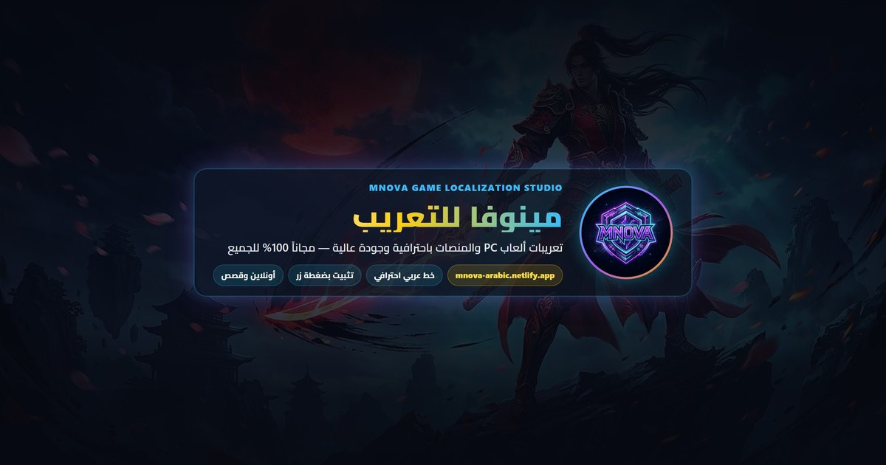

# 🎮 مينوفا للتعريب | MNOVA Arabic Game Localization Hub

**مركز تحميل تعريبات ألعاب الحاسب الشخصي (PC) ومنصة Steam باللغة العربية — مجاناً 100% للعب الشخصي، أو بالشراء المباشر مع تنازل كامل عن الحقوق.**

---

## 🌐 روابط الوصول السريع
* **الموقع الرسمي الكامل:** https://mnova-arabic.netlify.app/
* **دليل مكتبة التعريبات:** https://mnova-arabic.netlify.app/games/
* **قناة اليوتيوب الرسمية:** https://www.youtube.com/@MNOVA_Arabic
* **فيديو استعراض NARAKA: BLADEPOINT (2K60):** https://www.youtube.com/watch?v=EAxnnBAkZHE
* **متجر itch.io (الشراء وتملّك الحقوق):** https://m-amin-alobidan.itch.io

---

## 🎯 مكتبة التعريبات المتوفرة الآن (6 مشاريع)

| اللعبة / المنصة | الحالة | الحجم | صفحة الشرح والتحميل المباشر (SEO) | التحميل المجاني (LootLabs) | شراء وتنازل الحقوق (itch.io) |
| :--- | :--- | :---: | :--- | :---: | :---: |
| **NARAKA: BLADEPOINT** *(ناراكا: بليد بوينت — أونلاين)* | 🔄 مستمر (`362,699+` نص) | `172.6 MB` | [صفحة تعريب ناراكا](https://mnova-arabic.netlify.app/games/naraka-bladepoint-arabic/) | [تحميل مجاني ⚡](https://loot-link.com/s?zRIEpAsb) | [شراء `$5` 💎](https://m-amin-alobidan.itch.io/naraka-arabic) |
| **Nobody Wants to Die** *(لا أحد يريد أن يموت — UE5)* | ✅ مكتمل 100% | `209.7 MB` | [صفحة Nobody Wants to Die](https://mnova-arabic.netlify.app/games/nobody-wants-to-die-arabic/) | [تحميل مجاني ⚡](https://lootdest.org/s?HB2yrhVM) | [شراء `$2` 💎](https://m-amin-alobidan.itch.io/nobody-wants-to-die-arabic) |
| **Steam Client Arabic** *(تعريب منصة ستيم لنظام Windows)* | 🔄 مستمر (دعم RTL) | `0.8 MB` | [صفحة تعريب ستيم](https://mnova-arabic.netlify.app/games/steam-arabic/) | [تحميل مجاني ⚡](https://lootdest.org/s?2lDnErcN) | [شراء `$2` 💎](https://m-amin-alobidan.itch.io/steam-arabic) |
| **Ex Natura: Nature Corrupted** *(إكس ناتورا: الطبيعة الفاسدة)* | ✅ مكتمل 100% | `183.9 MB` | [صفحة Ex Natura](https://mnova-arabic.netlify.app/games/ex-natura-arabic/) | [تحميل مجاني ⚡](https://loot-link.com/s?typJ8L1j) | [شراء `$2` 💎](https://m-amin-alobidan.itch.io/ex-natura-arabic) |
| **The Pale Beyond** *(ما وراء الشحوب — بقاء سردي)* | ✅ مكتمل 100% | `19.3 MB` | [صفحة The Pale Beyond](https://mnova-arabic.netlify.app/games/the-pale-beyond-arabic/) | [تحميل مجاني ⚡](https://lootdest.org/s?aWcSLdpj) | [شراء `$2` 💎](https://m-amin-alobidan.itch.io/the-pale-beyond-arabic) |
| **Star Wars Jedi: Fallen Order** *(حرب النجوم جيدي)* | ✅ مكتمل 100% | `11.4 MB` | [صفحة Jedi Fallen Order](https://mnova-arabic.netlify.app/games/jedi-fallen-order-arabic/) | [تحميل مجاني ⚡](https://loot-link.com/s?aMdqYdUm) | [شراء `$2` 💎](https://m-amin-alobidan.itch.io/jedi-fallen-order-arabic) |

---

## 🛠️ مميزات تعريبات فريق MNOVA
* **تثبيت آمن بضغطة زر:** كل حزمة تحتوي على مثبّت تلقائي (`NarakaArabizer_AllInOne.exe` أو `SteamArabicInstaller.exe` أو ملفات `.bat` ذكية) يتعرّف تلقائياً على مجلد اللعبة في Steam أو Epic Games أو EA.
* **نسخ احتياطي تلقائي (`Orig_Backup`):** إمكانية استعادة ملفات اللعبة الأصلية في أي لحظة بأمان تام.
* **معالجة دقيقة للخط العربي (RTL + Reshaping):** خطوط مصقولة واضحة للقوائم، الحوارات، المهارات، الوثائق، والعروض السينمائية.
* **ربط قادم مع مشغّل NextGen Launcher:** [صفحة المشغّل على itch.io](https://m-amin-alobidan.itch.io/nextgen-launcher).

---

## ⚖️ سياسة الحقوق والاستخدام الواضحة
1. **التحميل المجاني للعب الشخصي (LootLabs):** خطوتان إعلانيتان خفيفتان تمنحانك كامل ملفات التعريب مجاناً 100% للاستخدام واللعب الشخصي فقط (مع بقاء حقوق التعريب لفريق MNOVA).
2. **الشراء المباشر بالمال (`$5` لناراكا الأونلاين / `$2` لبقية التعريبات عبر itch.io أو IBAN التركي):** بمجرد الشراء بالمال يتنازل فريق MNOVA عن جميع حقوقه في ملفات وأداة التعريب لتصبح **مِلكاً كاملاً للمشتري** (تتطلب الحزم وجود نسخة اللعبة الأصلية على جهاز المستخدم).

---

**صُنع لخدمة مجتمع اللاعبين العرب ❤️ — [MNOVA للتعريب](https://mnova-arabic.netlify.app/)**

